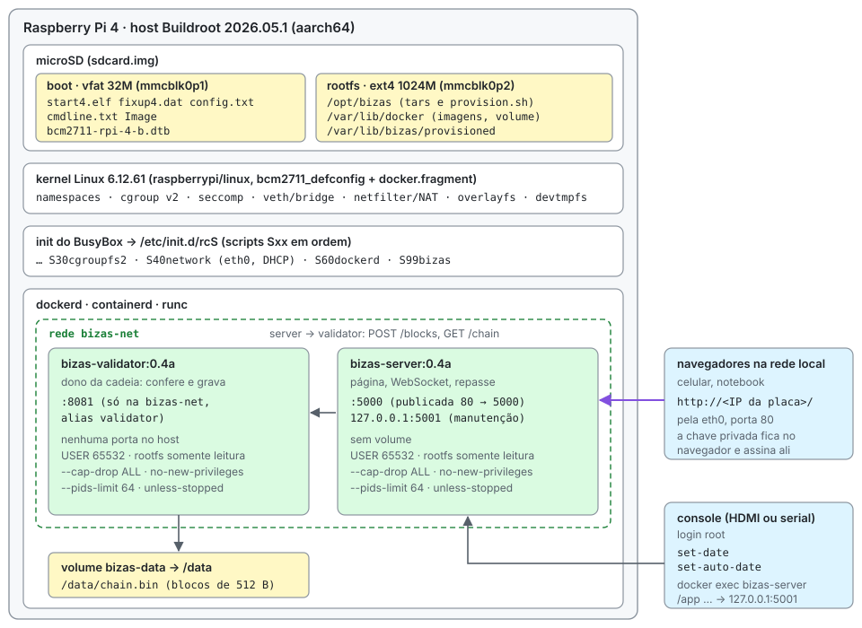
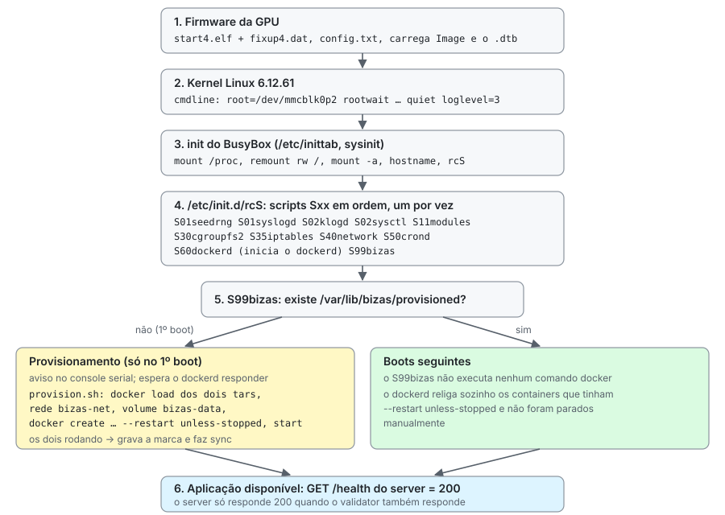

# 1. Arquitetura

O Bizas é um chat com histórico encadeado e assinado, servido por uma Raspberry Pi 4 a qualquer aparelho
da mesma rede. A placa roda uma imagem Linux própria, gerada com o Buildroot 2026.05.1, que contém só o
necessário para iniciar o Docker. A aplicação roda em dois containers. O protocolo das mensagens está em
[`docs/protocol.md`](../protocol.md). Este capítulo descreve como as peças se encaixam na placa.

## 1.1 Camadas

| Camada         | O que é                                                                                                     | Onde está definido                                                                                                  |
|----------------|-------------------------------------------------------------------------------------------------------------|---------------------------------------------------------------------------------------------------------------------|
| Cartão microSD | `sdcard.img`: partição de boot vfat de 32M (`mmcblk0p1`) e rootfs ext4 de 1024M (`mmcblk0p2`)               | `board/raspberrypi4-64/genimage.cfg.in` do Buildroot, `BR2_TARGET_ROOTFS_EXT2_SIZE`                                 |
| Firmware       | `start4.elf` e `fixup4.dat` da GPU, que leem `config.txt` e carregam o kernel `Image`                       | [`config.txt`](../../buildroot-external/board/bizas/rpi4/config.txt)                                                |
| Kernel         | Linux 6.12.61 da árvore `raspberrypi/linux`, `bcm2711_defconfig` mais o fragmento do Docker                 | [`kernel-config/docker.fragment`](../../kernel-config/docker.fragment), [capítulo 4](04-kernel-and-drivers.md)      |
| Init           | init do BusyBox; `/etc/inittab` e os scripts de `/etc/init.d`                                               | Buildroot (`BR2_INIT_BUSYBOX`), [`S99bizas`](../../rootfs-overlay/etc/init.d/S99bizas)                              |
| Docker         | `dockerd`, `containerd`, `runc` e `iptables`, do pacote `docker-engine`; o comando `docker` do `docker-cli` | [`buildroot.fragment`](../../buildroot-external/board/bizas/rpi4/buildroot.fragment), [capítulo 3](03-buildroot.md) |
| Aplicação      | `bizas-validator:0.3` e `bizas-server:0.3`, dois binários Go estáticos em imagens `FROM scratch`            | [`docker/`](../../docker), [`application/`](../../application), [`docs/containers.md`](../containers.md)            |
| Interface      | página web servida pelo `bizas-server`, aberta no navegador de outro aparelho                               | [`application/server/static/`](../../application/server/static)                                                     |

A imagem não tem ambiente gráfico. A interface do usuário é a página web, aberta em outro aparelho da
rede pelo endereço da placa. A tela e o teclado da placa servem só para manutenção.

## 1.2 Os dois containers

|                    | `bizas-validator`                                                                                             | `bizas-server`                                                                                  |
|--------------------|---------------------------------------------------------------------------------------------------------------|-------------------------------------------------------------------------------------------------|
| Papel              | único dono da cadeia: confere cada bloco (assinatura, encadeamento, sala, carimbo), grava e serve o histórico | serve a página e o WebSocket, repassa cada bloco ao validator e transmite os blocos confirmados |
| Porta no container | 8081                                                                                                          | 5000; manutenção em `127.0.0.1:5001`                                                            |
| Porta no host      | nenhuma                                                                                                       | 80 → 5000                                                                                       |
| Rede               | `bizas-net`, alias `validator`                                                                                | `bizas-net`                                                                                     |
| Volume             | `bizas-data` em `/data` (a cadeia em `/data/chain.bin`)                                                       | nenhum                                                                                          |
| Usuário            | 65532                                                                                                         | 65532                                                                                           |
| Opções de execução | `--restart unless-stopped --read-only --cap-drop ALL --security-opt no-new-privileges --pids-limit 64`        | as mesmas                                                                                       |
| Healthcheck        | `/app health` a cada 5 s                                                                                      | `/app health` a cada 5 s                                                                        |

A divisão em dois containers aplica o **privilégio mínimo**. O `bizas-server` é o único processo exposto
na rede, e não tem volume nenhum. Se ele for comprometido, não consegue reescrever a cadeia: só pode pedir
ao validator que acrescente blocos, e o validator confere a assinatura Ed25519 de cada um. O
`bizas-validator`, o único que grava, não tem porta publicada no host. O server nunca decide se uma
mensagem é válida.

As opções de execução estão em [`docker/provision.sh`](../../docker/provision.sh) (`COMMON_OPTS`), e o
usuário 65532 vem dos Dockerfiles. Nenhum container roda como root, em modo privilegiado, com o socket do
Docker montado ou com dispositivo repassado. O `scripts/containers-test.sh` confere cada uma dessas
propriedades com `docker inspect` (capítulo 6).

### Portas

| Porta                               | Quem escuta                                                                 | Alcance                                |
|-------------------------------------|-----------------------------------------------------------------------------|----------------------------------------|
| 80 no host → 5000 no `bizas-server` | página, `GET /health`, `GET /chain`, `GET /chain.json`, WebSocket `/ws`     | rede local, pela `eth0`                |
| 8081 no `bizas-validator`           | API interna: `GET /health`, `GET /chain`, `POST /blocks`                    | só a rede `bizas-net`; não é publicada |
| 5001 no `bizas-server`              | porta de manutenção (`POST /clock`, usada por `set-date` e `set-auto-date`) | só o loopback do próprio container     |

O server se recusa a iniciar se `ADMIN_ADDR` não for um endereço de loopback
([`application/server/main.go`](../../application/server/main.go), `requireLoopback`). Assim, a porta de
manutenção nunca fica alcançável pela rede, nem por engano de configuração.

### Rede e volume

- **Rede `bizas-net`:** definida pelo usuário, criada no provisionamento. Só numa rede assim o nome
  `validator` resolve pelo DNS embutido do Docker; na `bridge` padrão, não.
- **Volume `bizas-data`:** volume nomeado, montado em `/data` no validator. A imagem do validator cria
  `/data` com dono 65532, e um volume novo herda esse dono; sem isso, o usuário 65532 não conseguiria
  gravar. O conteúdo é só a cadeia, `chain.bin`, em blocos de 512 bytes, os mesmos que `GET /chain`
  exporta.

### Ordem de partida e saúde

Os dois containers sobem em paralelo. O server começa a escutar logo e tenta alcançar o validator por até
um minuto (`WaitValidator`). O `GET /health` do server só responde 200 quando o `GET /health` do validator
também responde 200; senão, responde 503 `validator unavailable`
([`application/server/server.go`](../../application/server/server.go)). Por isso, uma resposta 200 do
`/health` da porta 80 significa que a aplicação inteira está de pé: a página, o repasse e o dono da cadeia.

## 1.3 Fluxo de uma mensagem

1. O navegador monta o bloco de 512 bytes e o assina com a chave privada, que nunca sai do navegador. A assinatura
   tem de começar com N bits zero, sendo N o `info` do gênese (0 a 20, escolhido por quem cria a sala): o navegador
   soma 1 ao `nonce` e assina de novo até conseguir. É a prova de trabalho, descrita em
   [`docs/protocol.md`](../protocol.md).
2. O server recebe o bloco pelo WebSocket e o repassa ao validator (`POST /blocks`).
3. O validator confere o bloco contra a cabeça da cadeia, inclusive a prova de trabalho, grava em `chain.bin`, faz
   `fsync` e só então responde 200.
4. O server transmite o bloco confirmado a todos os navegadores conectados. Uma recusa volta só para quem
   enviou, com o código do erro em JSON.

O formato do bloco, os códigos de recusa e a regra do relógio estão em [`docs/protocol.md`](../protocol.md).

**Enquetes.** Uma extensão do chat, fora do protocolo em si, usa só os campos livres do bloco: o `type` `POLL` (7)
leva a pergunta e as opções, e o `type` `VOTE` (8) leva um voto ou a retirada dele, com o índice do bloco da enquete no
`info`. O validator confere as enquetes e os votos contra o estado da cadeia até ali
([`application/bizas/poll.go`](../../application/bizas/poll.go)): ninguém vota duas vezes na mesma opção, e, numa
enquete exclusiva, ninguém tem mais de um voto ativo. É um *soft fork*: as cadeias válidas com a extensão também são
válidas para um validator sem ela.

## 1.4 Fluxo de inicialização

1. **Firmware.** A GPU lê `config.txt`, carrega `start4.elf` e `fixup4.dat`, o device tree e o kernel
   `Image`, e passa ao kernel a linha de `cmdline.txt`.
2. **Kernel.** Monta o rootfs da partição 2 (`root=/dev/mmcblk0p2 rootwait`). Com `quiet loglevel=3`, só
   mensagens de nível menor que 3 (`KERN_ERR`) aparecem no console.
3. **init do BusyBox.** As linhas `sysinit` do `/etc/inittab` montam `/proc`, remontam `/` para escrita,
   montam o `/etc/fstab` (`/tmp` e `/run` em tmpfs), definem o hostname e rodam o `/etc/init.d/rcS`.
4. **rcS.** Roda, em ordem e um por vez, os scripts `S??*` de `/etc/init.d`: `S01seedrng`, `S01syslogd`,
   `S02klogd`, `S02sysctl`, `S11modules`, `S30cgroupfs2` (monta o cgroup v2), `S35iptables`, `S40network`
   (`ifup -a`: `eth0` por DHCP), `S50crond`, `S60dockerd` e `S99bizas`. O `S60dockerd` inicia o `dockerd`
   em segundo plano, com a saída repassada ao syslog.
5. **S99bizas.** Confere a marca `/var/lib/bizas/provisioned`:
   - **sem a marca (1º boot):** avisa no console que o `docker load` pode deixar a tela parada, espera o
     `dockerd` responder (até 300 tentativas de 0,2 s, ou seja, 60 s), roda `/opt/bizas/provision.sh` e
     espera os dois containers ficarem `running`. Só então grava a marca e faz `sync`. Se faltar energia
     no meio, a marca não existe e o boot seguinte tenta de novo;
   - **com a marca:** não executa nenhum comando `docker`. Quem religa os containers é o próprio `dockerd`,
     por causa do `--restart unless-stopped`.
6. **Aplicação disponível.** A aplicação está disponível na primeira resposta 200 de `GET /health` na
   porta 80, vista de outro aparelho da rede.

O `provision.sh` é idempotente: carrega uma imagem só se ela não existe, cria a rede e o volume só se não
existem, e recria um container só se ele for de outra versão. O provisionamento não baixa nada: os tars
das imagens vêm dentro do rootfs, em `/opt/bizas`.

No desligamento, o `S99bizas stop` não para os containers, de propósito. Um `docker stop` os marcaria
como parados manualmente, e o `unless-stopped` não os religaria no boot seguinte. Quem os para é o
`S60dockerd stop`, que encerra o `dockerd`.

### Tempo até a aplicação disponível

O tempo de inicialização é medido de outro equipamento da mesma rede, com
[`scripts/measure-boot.sh`](../../scripts/measure-boot.sh) `<IP da placa>`:

- a medição começa quando a alimentação é ligada: a pessoa aperta Enter no mesmo instante;
- o script consulta `GET /health` a cada 0,1 s, com tempo limite de 0,5 s por consulta, e para na primeira
  resposta 200;
- cada tentativa, aprovada ou não, vai para um CSV com data, URL, segundos e resultado (`pass` abaixo de
  15,0 s); sem resposta em 60 s, a tentativa é registrada como `no-response`;
- o script se recusa a começar se a URL já responde, o que indicaria a placa ainda ligada.

A medição vale para boots frios, depois do provisionamento do primeiro boot.

## 1.5 Acesso de manutenção

- **Console:** HDMI (`tty1`) ou serial (`ttyAMA0`, 115200 baud). O login é `root`, senha `bizasprotocol`.
  A imagem guarda só o hash SHA-256 crypt da senha em `/etc/shadow`.
- **Sem SSH:** a imagem não tem servidor SSH. A manutenção exige acesso físico à placa.
- **Comandos:** `set-date AAAA-MM-DD-hh-mm-ss [--tz FUSO]` informa a hora real à página (fuso padrão UTC);
  `set-auto-date` consulta a hora por SNTP em `pool.ntp.org`, `time.google.com` e `time.cloudflare.com`.
  Os dois estão em `/usr/bin` e fazem `docker exec bizas-server /app …`, que fala com a porta de manutenção
  `127.0.0.1:5001` de dentro do container. A hora informada fica só na memória do server e não muda os
  carimbos assinados. `reset-chat [--yes]` começa um chat novo: para o validator, arquiva `chain.bin` como
  `chain.bin.reset-<ns>` no volume (pelo `validator reset`, num container descartável da mesma imagem), religa o
  validator e reinicia o server. Sem `--yes`, pede para digitar `reset`. Nada é apagado.

## 1.6 Operação sem internet

Nada na operação depende da internet. As imagens dos containers estão na imagem do Buildroot, a página
embute o `tweetnacl` e o `qrcode-generator` (sem CDN), e o build dos binários Go usa `application/vendor/`
com `GOPROXY=off`. A hora de cada mensagem vem do relógio da placa. Só o `set-auto-date` usa a rede
externa, e ele é opcional.
