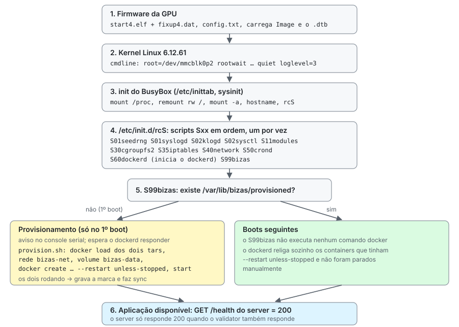

# 5. Boot e init

A aplicação precisa estar disponível **sem login e sem comando manual** depois que a placa é ligada. Este capítulo
descreve a sequência, os serviços que rodam, as escolhas que mantêm o caminho até a aplicação curto e o
procedimento de medição do tempo.

## 5.1 Sequência de boot



1. **Firmware.** A GPU lê `config.txt`, carrega `start4.elf` e `fixup4.dat`, o device tree e o kernel
   `Image`, e passa ao kernel a linha de `cmdline.txt`.
2. **Kernel.** Monta o rootfs da partição 2 (`root=/dev/mmcblk0p2 rootwait`). Com `quiet loglevel=3`, só
   mensagens de nível menor que 3 (`KERN_ERR`) aparecem no console.
3. **init do BusyBox.** As linhas `sysinit` do `/etc/inittab` montam `/proc`, remontam `/` para escrita,
   montam o `/etc/fstab` (`/sys`, `/dev/pts` e, em tmpfs, `/tmp`, `/run` e `/dev/shm`), definem o hostname e rodam
   o `/etc/init.d/rcS`.
4. **rcS.** Roda, em ordem e um por vez, os scripts `S??*` de `/etc/init.d` (seção 5.3). O `S60dockerd`
   inicia o `dockerd` em segundo plano, com a saída repassada ao syslog.
5. **S99bizas.** Confere a marca `/var/lib/bizas/provisioned` (seção 5.4).
6. **Aplicação disponível.** A aplicação está disponível na primeira resposta 200 de `GET /health` na
   porta 80, vista de outro aparelho da rede. O `getty` do login (um no HDMI e um na serial) é iniciado pelo
   `/etc/inittab` depois do `rcS`, e a aplicação não depende dele.

## 5.2 Firmware e linha de comando do kernel

Os dois arquivos ficam na partição de boot e vêm de
[`buildroot-external/board/bizas/rpi4/`](../../buildroot-external/board/bizas/rpi4):

| Arquivo       | Opção                                                              | Efeito                                                                               |
|---------------|--------------------------------------------------------------------|--------------------------------------------------------------------------------------|
| `config.txt`  | `start_file=start4.elf`, `fixup_file=fixup4.dat`                   | o firmware da GPU da Pi 4                                                            |
| `config.txt`  | `kernel=Image`, `arm_64bit=1`                                      | o kernel de 64 bits, sem compressão                                                  |
| `config.txt`  | `dtoverlay=miniuart-bt`                                            | devolve o `ttyAMA0` aos GPIOs 14 e 15, para o console serial (capítulo 4, seção 4.1) |
| `config.txt`  | `disable_splash=1`                                                 | sem a tela de arco-íris do firmware                                                  |
| `config.txt`  | `boot_delay=0`                                                     | sem atraso extra do firmware antes de carregar o kernel                              |
| `config.txt`  | `disable_overscan=1`, `gpu_mem_256`, `gpu_mem_512`, `gpu_mem_1024` | valores do `config.txt` de 64 bits do Buildroot, mantidos                            |
| `cmdline.txt` | `root=/dev/mmcblk0p2 rootwait`                                     | o rootfs na partição 2 do cartão, esperando o dispositivo aparecer                   |
| `cmdline.txt` | `console=tty1 console=ttyAMA0,115200`                              | HDMI e serial; a ordem importa (capítulo 9, seção 9.4)                               |
| `cmdline.txt` | `quiet loglevel=3`                                                 | só erros do kernel no console                                                        |

O `config.txt` é o de 64 bits de fábrica do Buildroot, mais `disable_splash=1` e `boot_delay=0`. Os dois arquivos
entram na imagem por `BR2_PACKAGE_RPI_FIRMWARE_CONFIG_FILE` e `BR2_PACKAGE_RPI_FIRMWARE_CMDLINE_FILE`
(capítulo 3).

## 5.3 init e serviços

O init é o do BusyBox (`BR2_INIT_BUSYBOX`). O `rcS` roda os scripts `S??*` de `/etc/init.d` em ordem e um por vez,
cada um com `start`:

| Script         | Origem                 | O que faz                                                                                                   |
|----------------|------------------------|-------------------------------------------------------------------------------------------------------------|
| `S01seedrng`   | Buildroot              | preserva a semente do gerador de números aleatórios entre os reinícios                                      |
| `S01syslogd`   | Buildroot              | o syslog do BusyBox; o log vai para `/var/log`, que aponta para `/tmp` (tmpfs)                              |
| `S02klogd`     | Buildroot              | repassa as mensagens do kernel ao syslog                                                                    |
| `S02sysctl`    | Buildroot              | aplica os arquivos `sysctl`, se houver                                                                      |
| `S11modules`   | Buildroot              | carrega os módulos listados em `/etc/modules-load.d/*.conf` (o `/dev` é só devtmpfs, sem `mdev` nem `udev`) |
| `S30cgroupfs2` | Buildroot              | monta o cgroup v2 em `/sys/fs/cgroup`, de que o Docker precisa                                              |
| `S35iptables`  | Buildroot              | carrega o `/etc/iptables.conf`, se existir; a imagem não traz esse arquivo                                  |
| `S40network`   | Buildroot              | `ifup -a`: `lo` e `eth0` por DHCP (`/etc/network/interfaces`)                                               |
| `S50crond`     | Buildroot              | o `crond` do BusyBox                                                                                        |
| `S60dockerd`   | pacote `docker-engine` | inicia o `dockerd` em segundo plano, com a saída repassada ao syslog                                        |
| `S99bizas`     | projeto                | provisiona os containers no 1º boot (seção 5.4)                                                             |

Só o `S99bizas` é do projeto ([`rootfs-overlay/etc/init.d/S99bizas`](../../rootfs-overlay/etc/init.d/S99bizas)); os
demais vêm do Buildroot e dos pacotes que a imagem seleciona. O `S99bizas` é o último, porque precisa do `dockerd`
no ar.

## 5.4 Provisionamento e religação dos containers

O `S99bizas` confere a marca `/var/lib/bizas/provisioned`:

- **sem a marca (1º boot):** avisa no console que o `docker load` pode deixar a tela parada, espera o `dockerd`
  responder (até 300 tentativas de 0,2 s, ou seja, 60 s), roda `/opt/bizas/provision.sh` e espera os dois
  containers ficarem `running`. Só então grava a marca e faz `sync`. Se faltar energia no meio, a marca não existe e
  o boot seguinte tenta de novo;
- **com a marca:** não executa nenhum comando `docker`. Quem religa os containers é o próprio `dockerd`, por causa
  do `--restart unless-stopped`.

O `provision.sh` é idempotente: carrega uma imagem só se ela não existe, cria a rede e o volume só se não existem, e
recria um container só se ele for de outra versão. O provisionamento não baixa nada: os tars das imagens vêm dentro
do rootfs, em `/opt/bizas`. O capítulo 6 descreve o que ele cria.

No desligamento, o `S99bizas stop` não para os containers, de propósito. Um `docker stop` os marcaria como parados
manualmente, e o `unless-stopped` não os religaria no boot seguinte. Quem os para é o `S60dockerd stop`, que encerra
o `dockerd`.

## 5.5 Escolhas que mantêm o caminho curto

Estas são as decisões aplicadas ao boot. Elas descrevem como o sistema é feito; o tempo resultante é o que o
procedimento da seção 5.6 mede.

- **Nenhum comando `docker` nos boots normais.** O `docker load` e a criação dos containers acontecem uma vez, no 1º
  boot. Depois, o `dockerd` religa os containers sozinho.
- **Esperas por sondagem, não por tempo fixo.** No 1º boot, o `S99bizas` consulta o `dockerd` e os containers a
  cada 0,2 s e segue assim que respondem.
- **Os dois containers sobem em paralelo.** O server não depende da ordem: ele atende desde o início, consulta o
  validator a cada pedido, e o seu `/health` só devolve 200 quando o validator também responde. Assim, o primeiro
  200 significa que a aplicação inteira está de pé.
- **Console silencioso e firmware sem espera:** `quiet loglevel=3`, `disable_splash=1` e `boot_delay=0`.
- **Containers sem nada a inicializar.** Cada imagem é `FROM scratch`, com um binário Go estático. Não há shell, nem
  interpretador, nem processo auxiliar.
- **O que não é usado:** o `initial_turbo`, porque o risco de uma fonte no limite não aguentar o pico durante o boot
  pesa mais que o ganho possível.

## 5.6 Medir o tempo até a aplicação disponível

O tempo é medido **de outro equipamento** da mesma rede, nunca de dentro da placa.

**Regra.** A medição começa quando a alimentação é aplicada e termina na primeira resposta 200 de `GET /health` (ou
da página), em boot frio: fonte desligada por alguns segundos, depois de o provisionamento do 1º boot ter terminado.
Valem três boots seguidos, cada um abaixo de 15,0 s, com todas as tentativas registradas, inclusive as que passarem
desse limite.

**Script.** [`scripts/measure-boot.sh`](../../scripts/measure-boot.sh), no notebook ligado à placa:

```sh
scripts/measure-boot.sh <IP da placa> evidence/boot/boot-measurements.csv
```

- a pessoa aperta Enter no mesmo instante em que liga a fonte; o cronômetro corre na tela;
- o script consulta `GET /health` seguidamente, com tempo limite de 0,5 s por consulta e pausa de 0,1 s entre elas, e
  para na primeira resposta 200;
- cada tentativa vai para o CSV, com data, URL, segundos e resultado: `pass` abaixo de 15,0 s, `FAIL` no restante,
  `no-response` se nada responde em 60 s. A pasta do CSV é criada se não existir;
- o script se recusa a começar se a URL já responde, o que indicaria a placa ainda ligada.

O instante do Enter depende da reação de quem aperta; por isso o vídeo deve mostrar a tomada e a tela juntas.

**Decomposição por dentro.** O `uptime` conta a partir do início do kernel, e o firmware não aparece no `dmesg`. No
console da placa, a linha do tempo se monta assim:

```sh
date +%s.%N; cat /proc/uptime                                      # relógio da placa e tempo desde o kernel, juntos
dmesg | tail -n 40                                                 # mensagens do kernel, com o tempo de cada uma
docker inspect -f '{{.Name}} {{.State.StartedAt}}' bizas-validator bizas-server
```

O `StartedAt` está no relógio da placa; o par `date` e `uptime`, lido junto, o converte para a escala do `uptime`. O
tempo do firmware não aparece em nenhum relógio da placa: ele se estima pela diferença entre o tempo externo desde a
energização e o `uptime`, lidos no mesmo instante. Para investigar o kernel,
`initcall_debug` pode ser acrescentado ao `cmdline.txt`, só durante a investigação, porque imprimir atrasa o boot; a
medição oficial usa o `cmdline.txt` final.
